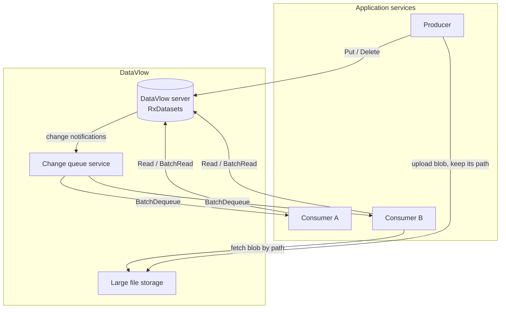
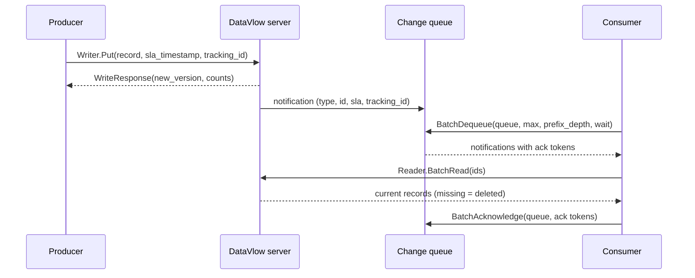

# 1. Concepts

## What DataVlow is

DataVlow is a way for the services of a system to share data. Services don't call each other's APIs to get data.
A producer writes typed records to a DataVlow server, and consumers are told about changes through a change queue.
The producer doesn't know who consumes its records, and a consumer has no runtime dependency on the producer.

**How it compares with REST calls.** With REST, service A calls service B to get data. A must know B's address and
API, and B must be up when A calls. If B is slow or down, A is blocked. With DataVlow, B writes its records to the
server. The change queue notifies every interested consumer, and each consumer reads the records from the server at
its own pace. A and B never depend on each other at runtime.

Fan-out comes for free. One write notifies any number of consumers, and the writer knows about none of them. Adding a
consumer is a configuration change in the consumer, and the producer doesn't change at all.

### The parts

| Part | Role |
|---|---|
| **DataVlow server** | Stores the current value of every record under a stable, hierarchical id. Per record type it serves a **Reader**, a **Writer** and a **History** gRPC service. Built on RxDatasets. |
| **Change queue service (CQS)** | Keeps one named queue per consuming service and delivers change notifications to it: ids only, no payloads, ordered by SLA, with long polling and explicit acknowledgement. |
| **Large file storage (LFS)** | Optional. A content-addressed, insert-only blob store for payloads that are too large or too binary for a record. A record holds only the file's path. See [Large files](03-change-queues.md#large-files). |



Where RxDatasets fits: it is the storage engine of the server. It keeps every record type as a dataset in object
storage, and it calls a *reporter* for every change. A change queue is one such reporter. The change queue service
itself is not part of RxDatasets. The [DataVlow server](10-datavlow-server.md) ships an in-memory one as a plugin,
and the [real-world servers](09-real-world-servers.md) bring their own.

## The change flow



1. **Write.** The producer calls `Put` with the record and an `sla_timestamp`, the time by which consumers should
   have processed the change.
2. **Fan-out.** The server stores the change, and every queue subscribed to the record type gets a notification. The
   notification carries the id and the type, not the record.
3. **Long poll.** The consumer calls `BatchDequeue`. On an empty queue the call waits up to the requested time. The
   first notification of a batch is always the most urgent one in the queue.
4. **Read.** The consumer reads the current records. There is no separate "deleted" notification: a record that
   reads as not found was deleted.
5. **Acknowledge.** After processing, the consumer acknowledges the notifications, and they leave the queue.

## Principles

- **One owner per record type.** Each record type has exactly one writing service. Where a value came from is never
  in doubt, and writes never conflict. Everyone else only reads it. If you ever need a second writer, for example
  during a migration, document it as an explicit, temporary exception.
- **Outputs are projections of inputs.** A processing service computes each record it writes from the records it
  consumes, and only from those. It never reads its own output back as an input: not to patch it, not to carry a
  value forward, and not to compare it before writing. Then any notification, duplicate or replay produces the
  correct result from scratch. A processor that patches its earlier output turns one bad write into a permanent one.
  *Exception:* a service that uses DataVlow as its system of record (an `order` registry that applies API patches,
  for example) reads and updates its own records. Every service that consumes those records is a processor and
  follows the rule.
- **Identical writes are no-ops.** When a written record is byte-for-byte equal to the stored one, nothing is stored
  and no consumer is notified. A consumer just writes what it computed, and an unchanged result ends the chain. See
  [Identical writes](02-contracts.md#identical-writes-are-no-ops).
- **Ids never change.** A record's id is set when the record is created. Ids can be cached and indexed safely.
- **Scope lives in the id.** Ids start with the tenant (and optionally a sub-scope), so isolation is a property of
  the data model.
- **Versioned schemas.** Non-breaking changes bump a minor version in place. Breaking changes ship as a new major
  version next to the old one.
- **Eventual consistency.** Changes propagate asynchronously. That fits systems where processing is asynchronous by
  nature, and it is what lets services deploy and fail independently.

## Records, ids and scope

### Ids

Every record has a string id made of `/`-separated segments. The segments come in pairs: a collection name and an
identifier. The id encodes the record's scope and its place in the hierarchy:

```
t/{tenantId}[/s/{siteId}]/{collection}/{identifier}
```

`t/{tenantId}` scopes the record to one tenant, and the optional `s/{siteId}` narrows it to a sub-scope within the
tenant. No id spans tenants. The collection name (`items`, `orders`, ...) is normally the plural of the record type.

| Scope | Pattern | Example |
|---|---|---|
| Global | `{collection}/{id}` | `currencies/EUR` |
| Tenant | `t/{tenantId}/{collection}/{id}` | `t/acme/customers/c-1042` |
| Tenant and site | `t/{tenantId}/s/{siteId}/{collection}/{id}` | `t/acme/s/site01/orders/o-9982` |
| Singleton per site | `t/{tenantId}/s/{siteId}/{collection}` | `t/acme/s/site01/sitesettings` |
| Singleton per tenant | `t/{tenantId}/{collection}` | `t/acme/tenantsettings` |

Ids work like paths. Every prefix of an id is a **parent**, and the reader and writer have operations on all
children of a parent: `ReadChildren`, `ListChildren`, `CountChildren`, `DeleteChildren` and `PutAllChildren`.
RxDatasets stores the ids as a tree, so these operations are cheap.

RxDatasets itself accepts any non-empty name. `Writer:AllowedNamesPattern` (a regular expression) restricts the
names a server accepts, and `DeleteChildren` requires an ancestor made of whole pairs. A server that knows its record
types (all the servers in this guide) also checks each id against the type's id pattern.

### Id patterns

A record type declares the shape of its ids on its `id` field, in a comment:

```proto
message Order {
  // minor version 1

  // __idpattern__ t/{tenantid}/s/{siteid}/orders/{orderid}
  string id = 1;
  string customer_id = 2;
  repeated OrderLine lines = 3;
}
```

A write whose id doesn't match the pattern is rejected. A pattern that contains `{tenantid}` makes the type
tenant-scoped; see [Security](02-contracts.md#security-and-tenant-isolation).

Never change the collection names or the id pattern of a type that has shipped: stored ids are permanent.

### Several id patterns per type

A type may declare more than one `__idpattern__` when the same kind of record really exists at more than one scope,
typically a global default plus per-tenant overrides:

```proto
message Currency {
    // __idpattern__ currencies/{code}
    // __idpattern__ t/{tenantid}/currencies/{code}
    string id = 1;
}
```

- Patterns are tried in order, and the first match decides the record's scope.
- No id may match two patterns. A global pattern never starts with `t/`, so `currencies/{code}` and
  `t/{tenantid}/currencies/{code}` can't overlap. Check this in CI.
- Security follows the matched pattern: a tenant id can be written by that tenant, a global id only by the operator
  (root) tenant, and every authenticated caller can read a global id.
- There is still one owner for every record of the type, whichever pattern it matches.
- The server never falls back from a missing tenant record to the global one. A consumer that wants "the override,
  or else the default" reads both. Fallback is product policy, not data plumbing.
- Use this only when overrides are a real requirement. Otherwise one pattern, or two separate types, is clearer.

### Aliases

An **alias** is a second lookup path for the same record, kept up to date by the server next to the id index.
Example: `order` records are keyed by `t/{t}/s/{s}/orders/{orderid}`, and consumers often ask for "the orders of
customer X". A `by_customer` alias maps each order to `t/{t}/s/{s}/customers/{customerid}/orders/{orderid}`, so
`ReadChildren(parent = t/acme/s/site01/customers/c-1042, alias_name = "by_customer")` returns that customer's
orders.

In a proto, an alias is one comment line with a name, the alias id pattern and the expression that computes it:

```proto
message Order {
  // __idpattern__ t/{tenantid}/s/{siteid}/orders/{orderid}
  // __alias_name__ by_customer __aliaspattern__ t/{tenantid}/s/{siteid}/customers/{customerid}/orders/{orderid} __aliasexpression__ t/{tenantid}/s/{siteid}/customers/{.customer_id}/orders/{orderid}
  string id = 1;
  string customer_id = 2;
}
```

In the expression, `{.field}` reads a field of the record, `{name}` takes the id segment of the same name,
`items[]` walks a repeated field (one alias per element), and `{.id/[..4]}` takes id segments. The full language is
in the [aliasing README](../../src/RxDatasets.Aliasing/README.md). A hand-written server registers the same
definitions in code with `AddDatasetAliases<T>(...)`; see [Aliases](08-dataset-lifecycle.md#aliases).

- `Read`, `BatchRead`, `ReadChildren`, `ListChildren`, `CountChildren`, `BatchLookup` and the batch child calls
  accept `alias_name`. They return the canonical record behind the alias.
- A field that is empty for a record produces no alias for that record.
- `CountChildren` with an alias counts alias entries. Several entries can point to the same record.
- Two records can't claim the same alias. Such a write fails as a whole (`AliasConflictException` in RxDatasets),
  and nothing is stored.
- A queue can subscribe to a type through an alias. It is then told when the alias **mapping** changes, not when the
  content of the target record changes. See [Alias-watch cleanup](03-change-queues.md#pattern-alias-watch-cleanup).

### Singleton configuration records

Configuration that applies to a whole scope, is always read as a unit and rarely changes is best modelled as **one
singleton record**, not as a collection of per-key records:

```
t/{tenantid}/s/{siteid}/sitesettings
```

As a collection, every consumer would have to assemble the full view, cope with half-updated states during bulk
changes, and handle a notification per entry. When the fields form one policy, a partial update is an inconsistency
that a singleton can't have.

- The id is deterministic: any service can derive it from the tenant and site, without a lookup.
- The writer replaces the whole record on every change. It reads the record, applies the change and writes all of it.
- **A missing singleton means "all defaults".** It doesn't exist until it is first written, so consumers must handle
  not found. Choose proto3 zero values that are safe defaults.
- Trade-offs: when two administrators edit different fields at the same moment, the last writer wins (fine at human
  timescales). A consumer can't subscribe to one field. History is per record, not per field.

## Versions and history

RxDatasets numbers the writes of a dataset. Every write that changes something creates a new **dataset version**,
one higher than the last. A write that changes nothing (identical records, deleting a missing id) creates no
version. Each record also remembers the version that last changed it and the version before that, so its history
is a chain.

The version is what a consumer uses as a cursor: "give me everything that changed since version 41". Because it is
per dataset and strictly increasing, a consumer that stores the last version it processed can always resume. See
[Following changes](02-contracts.md#following-changes).

How far back history reaches depends on cleaning: history lives in the deltas, and
[cleaning](08-dataset-lifecycle.md#cleaning) can delete old deltas. With `Cleanup:KeepAllDeltas` left on (the
default), the full history is kept.

## Record types and versioning

- One file per type and major version: `{type}.v{N}.proto`, for example `order.v1.proto` and `order.v2.proto`.
- **Minor, non-breaking changes** (adding a field, deprecating one, changing comments) edit the file in place and
  bump the minor version comment:

  ```proto
  message Order {
    // minor version 3
    string id = 1;
    string customer_id = 2;
    string currency = 3;            // added in minor version 2
    repeated string tag_ids = 4;    // added in minor version 3
  }
  ```

  Older readers ignore unknown fields, so rolling deployments are safe.
- **Major, breaking changes** (removing a field, changing its meaning, restructuring) get a new `.v{N+1}.proto` next
  to the old one. Both versions are served at once, each as its own dataset. Consumers move over at their own pace.
  During the migration the producer writes both versions, or a bridge service projects one into the other. When no
  consumer is left, the old version becomes read-only and is later removed.
- **Serialize repeatably.** The server compares bytes to detect identical writes. A protobuf `map` has no defined
  order on the wire, so use a `repeated` message with an explicit key instead, and write `repeated` fields in a
  stable order. A record that serializes differently every time is a change every time, and it wakes every consumer
  downstream.
- **Document each type the same way:** its role, its owner, its scope and id pattern with an example, its current
  minor version and what changed, its fields, aliases, consumers and related types.
- **Check in CI:** proto lint and breaking-change checks (with `buf`, for example), the minor version bump, and that
  multiple id patterns can't overlap.

## Sharing data between services

The architectural rule behind all of this: **services share entity data only through DataVlow.** A producer writes
records through the writer. A consumer reads current state through the reader and subscribes to changes through its
queue. No service calls another service's API to read entity state.

What follows from it:

- A producer writes its records and owes nobody anything else.
- A consumer owns its queue and declares the types it watches.
- Dependencies between services are record types and id patterns, not endpoints.
- Services deploy independently. A consumer that is down while a producer writes gets the notifications when it is
  back.
- New consumers join an existing feed without any change to the producer.
- Bootstrapping is simple: read the current state, then follow the changes.

What you accept in return: every service depends on DataVlow (but not on each other), end-to-end latency is the write
plus the notification, and the system is eventually consistent. Tracking ids, history and no-write reports keep the
asynchronous chain traceable ([Tracking ids](02-contracts.md#tracking-ids)).
